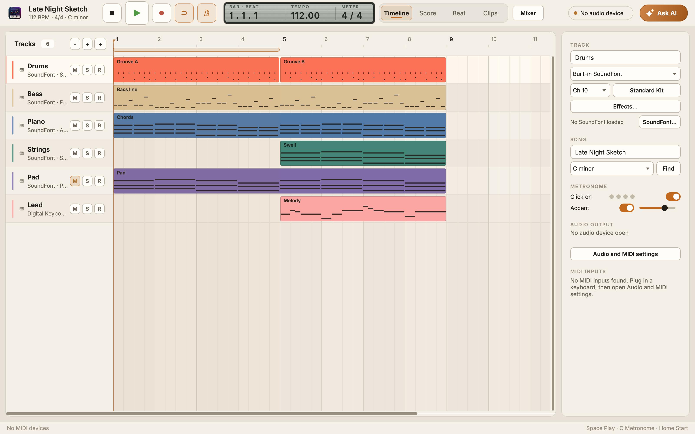

# Arranger MIDI DAW

The arranger’s DAW. Compose, arrange, score and perform in one desktop studio.

## Compose

Record MIDI and audio. Edit notes in the piano roll. Comp takes and shape each part. Analyse audio into stems, notes, chords and lyrics.

## Arrange

Build scenes in the Clip grid. Write patterns in the Beat view. Fill tracks with chord-following parts from Yamaha style files. Slice loops and play the slices as pads.

## Deliver

Turn the arrangement into a full score with chords, lyrics and dynamics. Print it. Export PDF or MusicXML. Mix with buses, sends, VST3 or AU plugins. During playback, a live cursor follows the score.

## Features

- **Timeline:** scrollbars, vertical track zoom and clips with black notes and waveforms.
- **Beat view:** square steps that follow playback.
- **Clip grid:** launch scenes and loops, and record the performance to the Timeline.
- **Arranger styles:** open and save Yamaha `.sty` and `.prs` files.
- **Slicer and drum kits:** slice loops at each hit, by equal parts or by hand.
- **Score editor:** full scores, grand staves, drum staves, chords, lyrics, dynamics and guitar chords.
- **Audio:** WAV, AIFF, FLAC, Ogg and, on macOS, MP3 and M4A. Record to WAV and follow the song tempo.
- **Plugins:** VST3 and Audio Unit instruments and effects.
- **Automation:** volume, pan, sends and plugin controls.
- **AI assistant:** a local MCP connection. Each change is one undo step.

## Works with

- Yamaha arrangers
- MIDI controllers
- MIDI mixers

Tested with the Yamaha PSR-S970, Novation Launchkey Mini MK3, Behringer X-Touch Mini, Roland D-05 and Novation XioSynth 49. Other models were not tested.

## Learn more

- Feature sheet: a two-page overview of the app, as [PDF](docs/Arranger-MIDI-DAW-Feature-Sheet.pdf) or [Word](docs/Arranger-MIDI-DAW-Feature-Sheet.docx)
- [User manual](docs/user-manual.md): how to use the app, in simple English
- [Technical overview](docs/technical-overview.md): stack, architecture and devices
- [Build plan](docs/build-plan.md): phases, risks and open questions
- [Device profiles](docs/device-profiles.md): teach the app a new synth with one YAML file
- [Controller mixer pages](docs/controllers.md): what each knob and button does
- [Self-hosted CI](docs/ci-self-hosted.md): the build machines and the hand-off notes
- [Building and code layout](docs/building.md): how to build, run the tests, folders and shortcuts
- [Style guide](docs/style-guide.md): colours, type and layout
