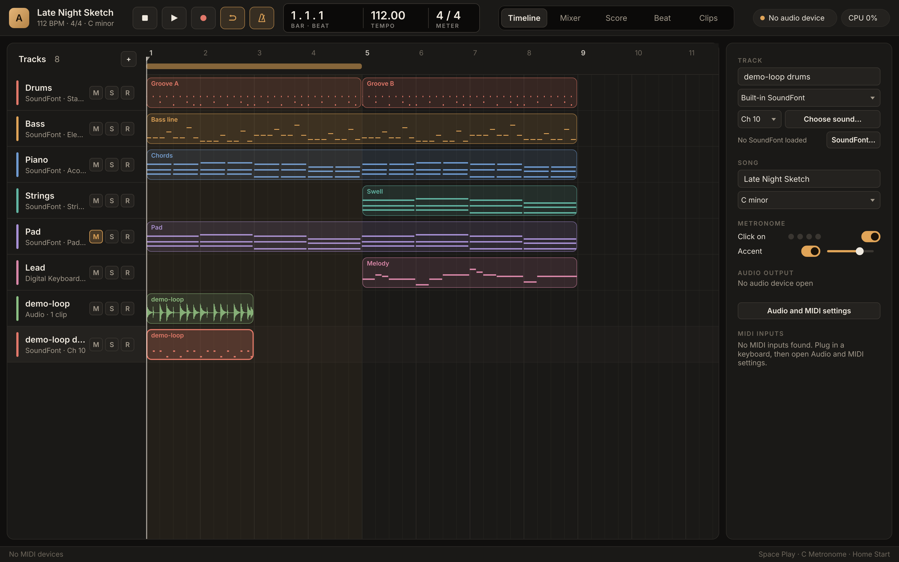
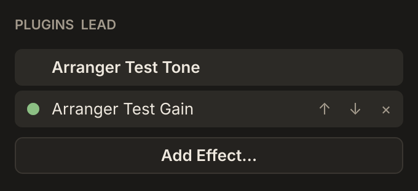
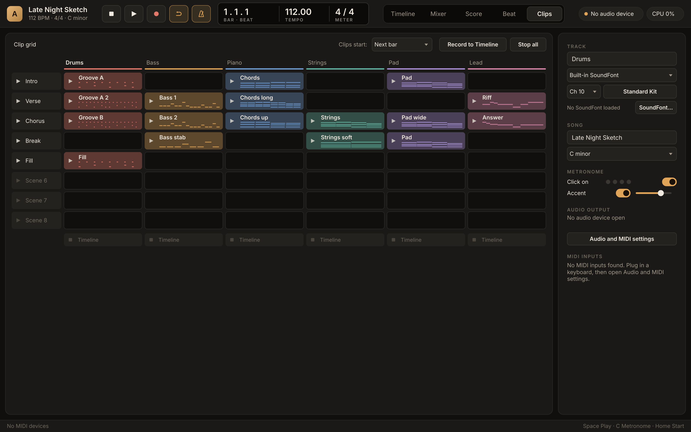
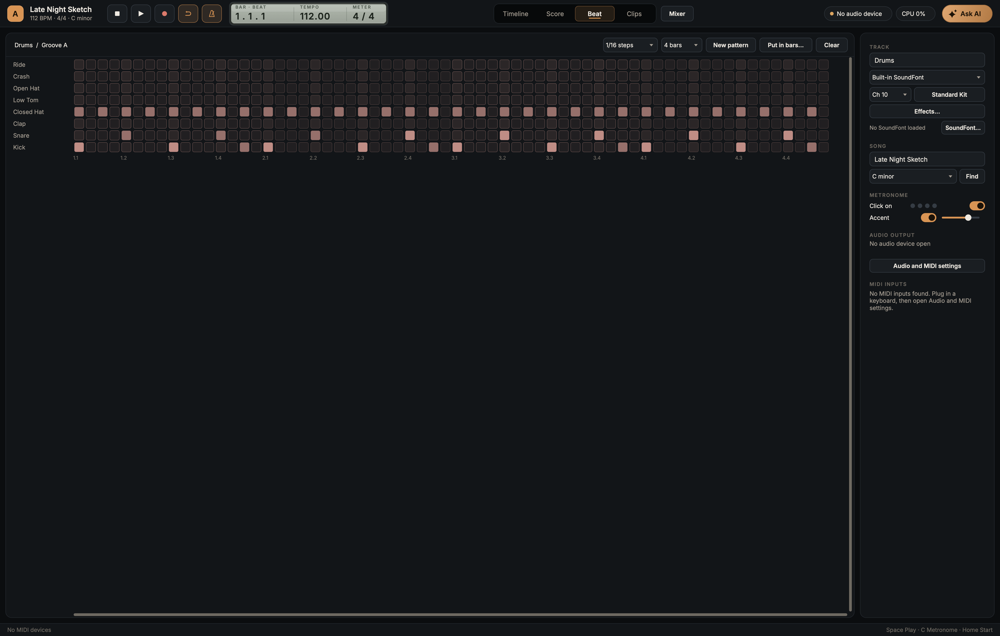

# Arranger MIDI DAW

A light, fast MIDI sequencer and DAW for people who play keyboards. Sequence tracks, read and write real score notation, build beats, launch loops, edit arranger styles for your Yamaha, and play your hardware synths, all in one app.

**Status:** Phase 7. You can record and edit MIDI on tracks, edit notes in the piano roll, mix, build beats in a step sequencer, play your own samples, slice drum loops, and launch clips and scenes in a clip grid. You can open, edit and save Yamaha styles (PSR-S970 and others), make a style from a MIDI file, and play it with chords from your keyboard. The Score view shows any track as printed music: write and edit notes with the mouse, the computer keyboard or your MIDI keyboard, add chord symbols, lyrics, dynamics and articulations, print or export PDF, and exchange scores with Sibelius, Dorico or MuseScore through MusicXML. It plays through the built-in SoundFont player, the drum sampler or your hardware. Audio tracks play, record and edit WAV files: clips with waveforms, gain and fades, loops that follow the song tempo, and audio to MIDI for melody lines and drum hits. VST3 and Audio Unit plugins work as instruments and as effects on tracks and on the master, with a crash-safe scan and settings saved in the project.

**The app today**

## Screens

> Design mockups for the phases ahead. The final look may change.

**Timeline and piano roll**

**Clip grid and Beat view**

**Score**

**Audio tracks and sample slicer**

## Highlights

- Timeline, piano roll and score views over the same notes
- Drum machine, sample slicer and a clip grid for live looping
- Arranger style editor for the Yamaha PSR-S970, with MIDI to style conversion
- Ready-made support for PSR-S970, Roland D-05, Launchkey Mini MK3, XioSynth 49 and Behringer X-Touch Mini, open to any synth
- Built-in SoundFont player for your SF2 files
- macOS first, also Windows and Linux

## Learn more

- [User manual](docs/user-manual.md): how to use the app, in simple English
- [Technical overview](docs/technical-overview.md): stack, architecture and devices
- [Build plan](docs/build-plan.md): phases, risks and open questions
- [Device profiles](docs/device-profiles.md): teach the app a new synth with one YAML file
- [Controller mixer pages](docs/controllers.md): what each knob and button does
- [Self-hosted CI](docs/ci-self-hosted.md): the build machines and the hand-off notes
- [Building and code layout](docs/building.md): how to build, run the tests, folders and shortcuts
- [Style guide](docs/style-guide.md): colours, type and layout
