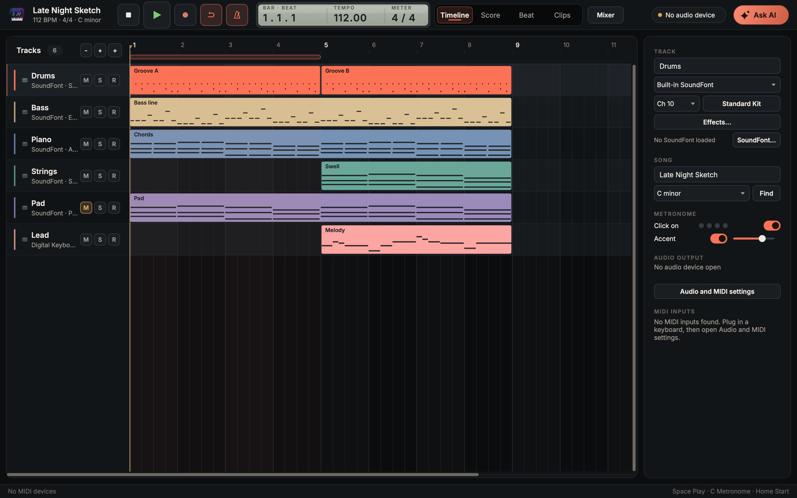
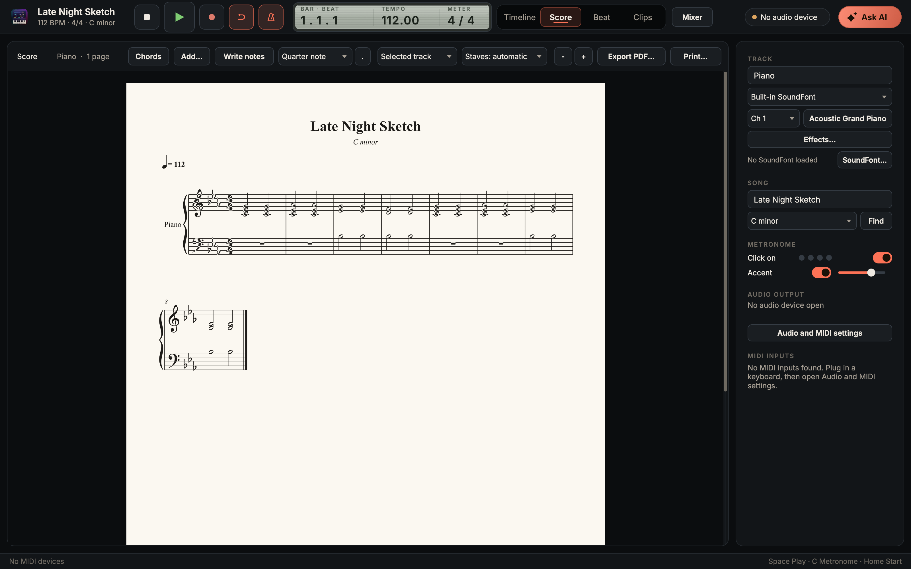
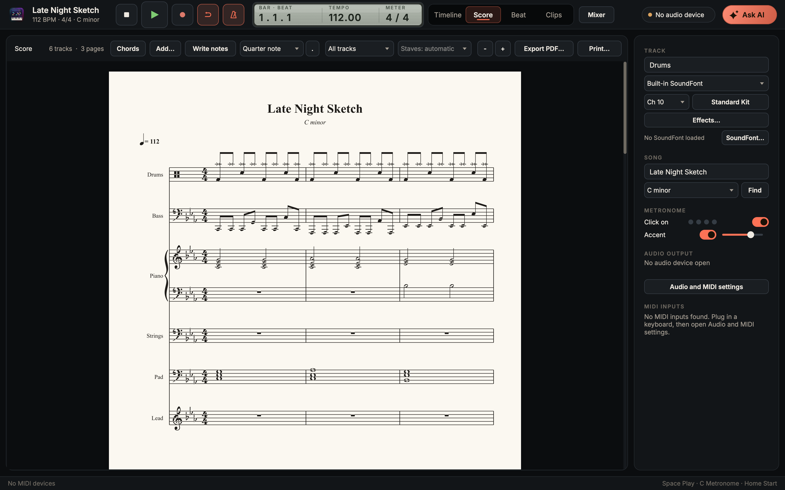
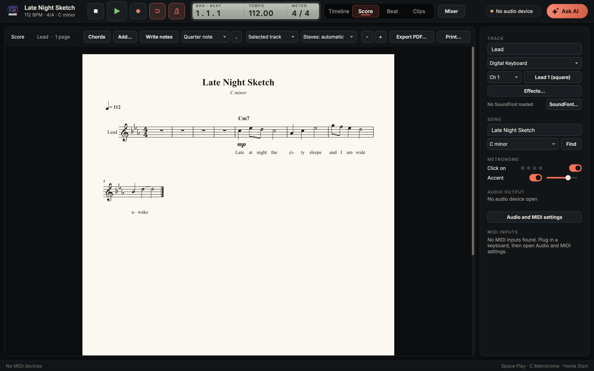
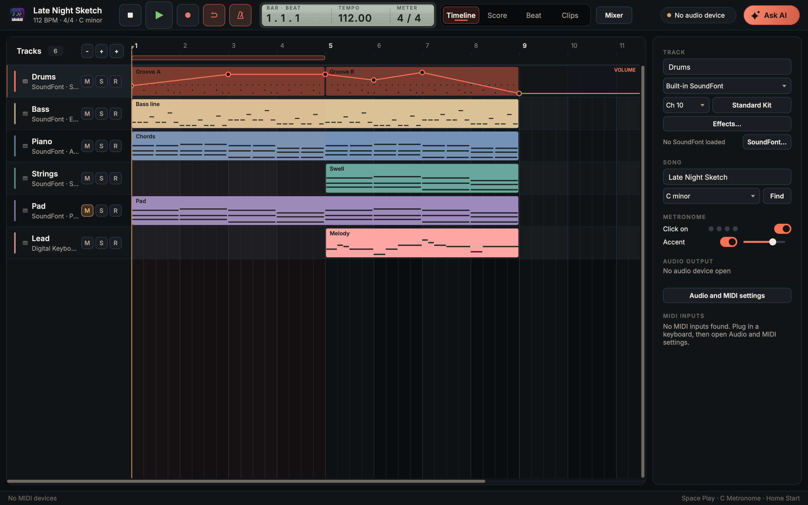
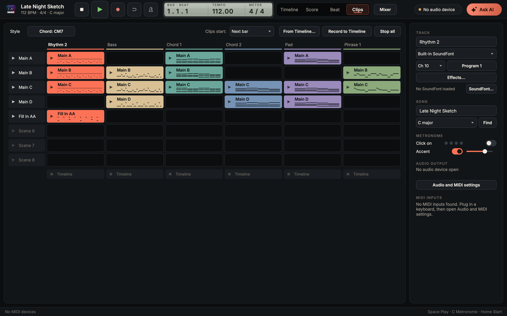
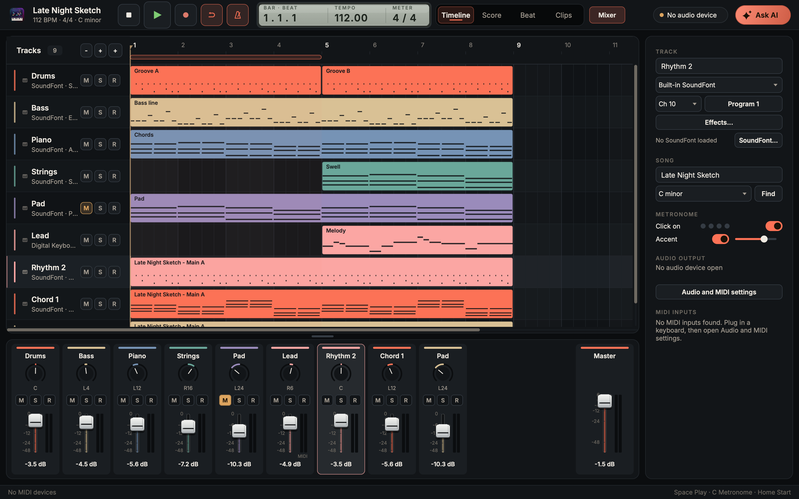
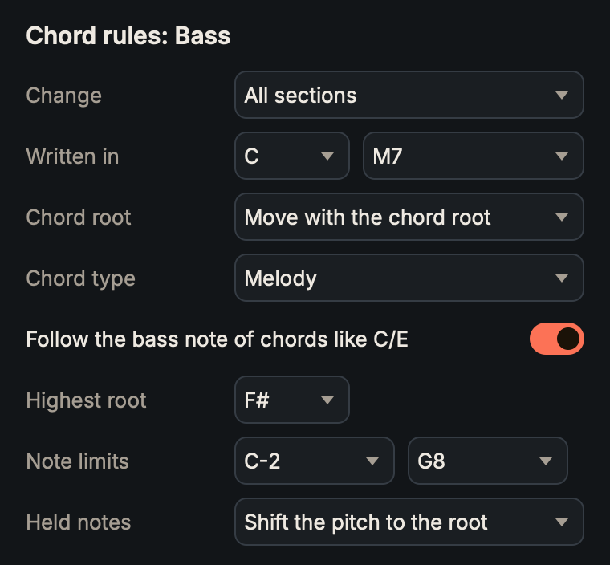
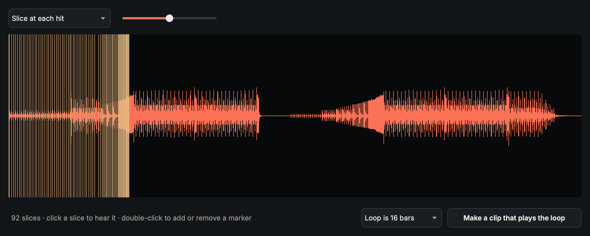

# Arranger MIDI DAW

A MIDI sequencer and DAW for keyboard players. Compose, arrange, score and perform in one app.

**Status:** Phase 8. The app records and edits MIDI and audio on tracks. It has a piano roll, a step sequencer, a clip grid, a mixer and a score editor. It also has an arranger style editor for Yamaha keyboards. It plays through a SoundFont player, a drum sampler, VST3 or AU plugins, or MIDI hardware. It reads and writes MIDI, MusicXML and Yamaha style files.

The Timeline has scrollbars, vertical track zoom and clips with black notes and waveforms. The Beat view uses square steps and follows playback. The Clip grid uses the same track colours. The Score view shows one track, selected tracks or a full score. Write notes with the mouse, computer keyboard or MIDI keyboard. Add chords, lyrics, dynamics and articulations. Export PDF or MusicXML. During playback, a live cursor follows the music.

Audio tracks play WAV, AIFF, FLAC, Ogg and (on macOS) MP3 and M4A files. They record to WAV, show waveforms, and follow the song tempo. VST3 and Audio Unit plugins work as instruments and effects. Automation covers volume, pan, sends and plugin controls. Buses group tracks on one fader or share one effect.

**The app today**

## Highlights

- Timeline, piano roll and score views over the same notes
- Drum machine, sample slicer and a clip grid for live looping
- Arranger style editor for the Yamaha PSR-S970, with MIDI to style conversion
- Ready-made support for PSR-S970, Roland D-05, Launchkey Mini MK3, XioSynth 49 and Behringer X-Touch Mini
- Built-in SoundFont player for SF2 files
- Runs on macOS, Windows and Linux

## Learn more

- Feature sheet: a two-page overview of the app, as [PDF](docs/Arranger-MIDI-DAW-Feature-Sheet.pdf) or [Word](docs/Arranger-MIDI-DAW-Feature-Sheet.docx)
- [User manual](docs/user-manual.md): how to use the app, in simple English
- [Technical overview](docs/technical-overview.md): stack, architecture and devices
- [Build plan](docs/build-plan.md): phases, risks and open questions
- [Device profiles](docs/device-profiles.md): teach the app a new synth with one YAML file
- [Controller mixer pages](docs/controllers.md): what each knob and button does
- [Self-hosted CI](docs/ci-self-hosted.md): the build machines and the hand-off notes
- [Building and code layout](docs/building.md): how to build, run the tests, folders and shortcuts
- [Style guide](docs/style-guide.md): colours, type and layout
