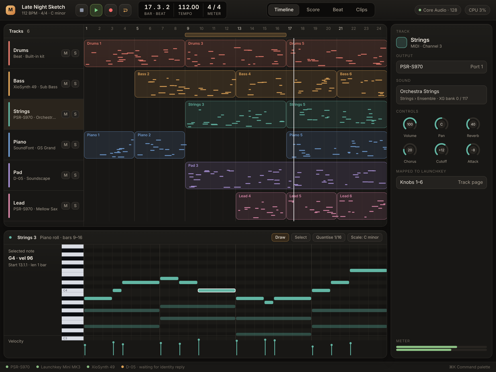

# Arranger MIDI DAW

A light, fast MIDI sequencer and DAW for people who play keyboards. Sequence tracks, read and write real score notation, build beats, launch loops, edit arranger styles for your Yamaha, and play your hardware synths, all in one app.

**Status:** Phase 1. You can record and edit MIDI on tracks, edit notes in the piano roll, mix, play through the built-in SoundFont player or your hardware, and import and export MIDI files. Score, beats, clips, styles and audio are planned; the mockups further down show where it's going.

**The app today**

## Screens

> Design mockups for the phases ahead. The final look may change.

**Timeline and piano roll**

**Clip grid and Beat view**

**Score**

**Audio tracks and sample slicer**

## Highlights

- Timeline, piano roll and score views over the same notes
- Drum machine, sample slicer and a clip grid for live looping
- Arranger style editor for the Yamaha PSR-S970, with MIDI to style conversion
- Ready-made support for PSR-S970, Roland D-05, Launchkey Mini MK3, XioSynth 49 and Behringer X-Touch Mini, open to any synth
- Built-in SoundFont player for your SF2 files
- macOS first, also Windows and Linux

## Learn more

- [Technical overview](docs/technical-overview.md): stack, architecture and devices
- [Build plan](docs/build-plan.md): phases, risks and open questions
- [Device profiles](docs/device-profiles.md): teach the app a new synth with one YAML file
- [Controller mixer pages](docs/controllers.md): what each knob and button does
- [Building and code layout](docs/building.md): how to build, run the tests, folders and shortcuts
- [Style guide](docs/style-guide.md): colours, type and layout
