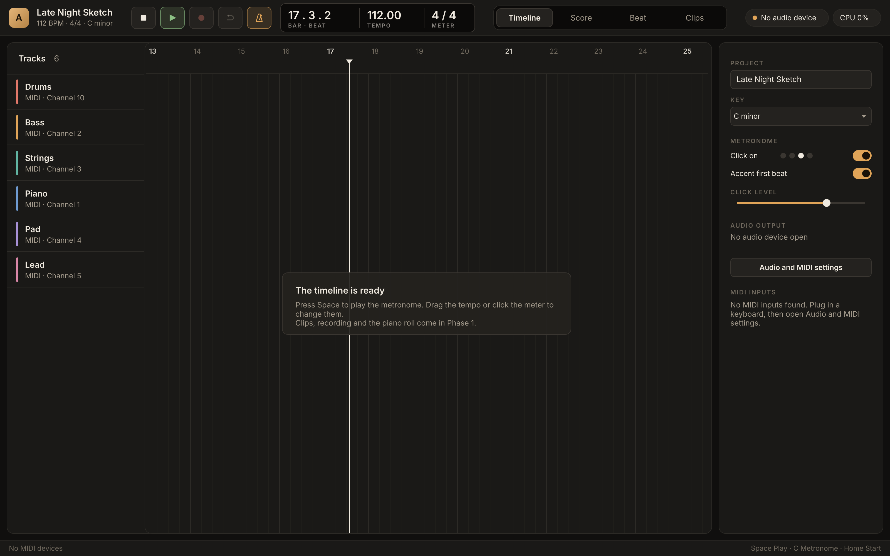
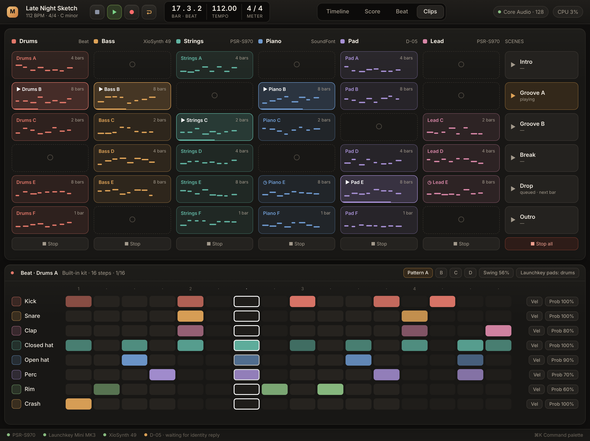
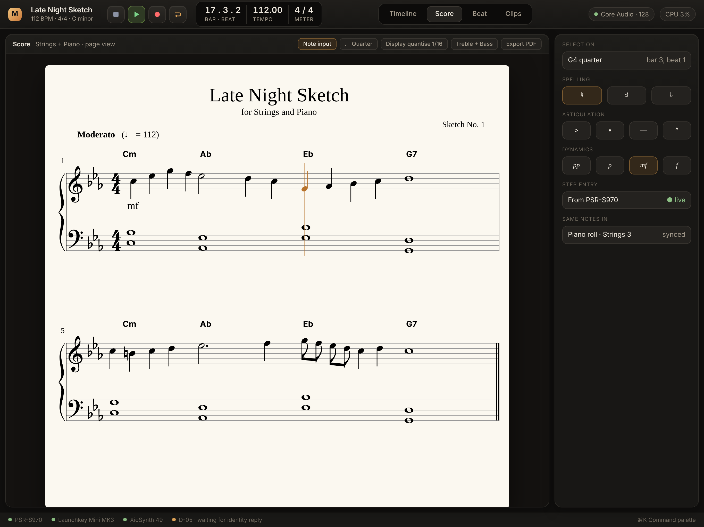
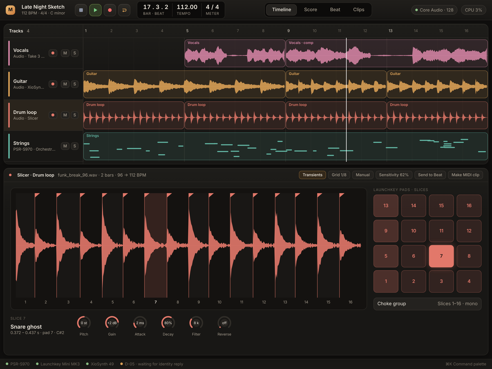

# Arranger MIDI DAW

A light, fast MIDI sequencer and DAW for people who play keyboards. Sequence tracks, read and write real score notation, build beats, launch loops, edit arranger styles for your Yamaha, and play your hardware synths, all in one app.

**Status:** Phase 0 (skeleton). The app opens a window, plays a sample-accurate metronome through your audio device, shows incoming MIDI, and saves and loads projects. Everything else is planned; the mockups below show where it's going.

**The app today (Phase 0)**



## Screens

> Design mockups for the phases ahead. The final look may change.

**Timeline and piano roll**


**Clip grid and Beat view**



**Score**



**Audio tracks and sample slicer**



## Highlights

- Timeline, piano roll and score views over the same notes
- Drum machine, sample slicer and a clip grid for live looping
- Arranger style editor for the Yamaha PSR-S970, with MIDI to style conversion
- Ready-made support for PSR-S970, Roland D-05, Launchkey Mini MK3, XioSynth 49 and Behringer X-Touch Mini, open to any synth
- Built-in SoundFont player for your SF2 files
- macOS first, also Windows and Linux

## Build

You need CMake 3.24+ and a C++20 compiler: Xcode on macOS, Visual Studio 2022 on Windows, GCC 11+ or Clang 14+ on Ubuntu. JUCE, Catch2 and nlohmann/json are downloaded by CMake.

```sh
cmake -S . -B build -DCMAKE_BUILD_TYPE=Release
cmake --build build --config Release --parallel
ctest --test-dir build -C Release        # unit tests
```

The app is in `build/src/app/ArrangerMidiDaw_artefacts/Release/`. On Ubuntu, first install the JUCE packages listed in `.github/workflows/ci.yml`.

Useful options:

- `-DARRANGER_BUILD_APP=OFF` builds only the core, engine and tests, with no JUCE.
- `-DARRANGER_JUCE_DIR=/path/to/JUCE` uses a local JUCE checkout instead of downloading it.

The app also takes `--screenshot out.png [--theme light] [--position ticks] project.arranger` to render its window to an image without opening any device. CI uses this to show the app on all three systems.

## Code layout

| Folder | What | JUCE? |
| --- | --- | --- |
| `src/core` | Song model, timing, project file | No |
| `src/engine` | Real-time engine: transport, metronome, processor interface, lock-free queue | No |
| `src/platform` | Audio and MIDI devices behind our own `DeviceHost` interface; `juce/` has the JUCE version | Only `juce/` |
| `src/app` | Window, UI and theme | Yes |
| `tests` | Catch2 tests for core and engine | No |
| `resources` | Themes (JSON) and the Inter font | |

CI checks that `src/core` and `src/engine` never mention JUCE.

## Shortcuts

Space play/stop, Home or Enter back to start, C metronome, Cmd/Ctrl+N new, +O open, +S save, +Shift+S save as, +, audio and MIDI settings.

## Learn more

- [Technical overview](docs/technical-overview.md): stack, architecture and devices
- [Build plan](docs/build-plan.md): phases, risks and open questions
- [Style guide](docs/style-guide.md): colours, type and layout
