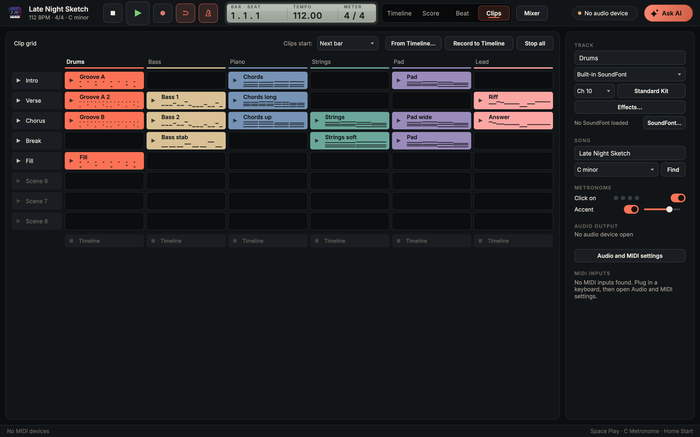

# Lazy Arranger Midi DAW

Lazy Arranger Midi DAW is a MIDI arranger DAW with AI assist. Compose, arrange, score and perform in one desktop studio.

## Timeline

Make the song. Record MIDI and audio, edit notes in the piano roll, comp takes and crossfade clips. Move sections, loop a range, quantise, split and join clips. Draw automation for volume, pan, sends and any plugin control. Analyse audio into stems, notes, chords, instruments and lyrics.

## Score

Turn the music into printed notation. Read and write full scores, grand staves and drum staves. Enter notes with the mouse, the computer keyboard or a MIDI keyboard. Add chord symbols, lyrics, dynamics and articulations. Find chords from the notes. Print the score or export PDF, and exchange MusicXML with other notation programs.

## Drums

Build a drum pattern step by step. Choose the step size and pattern length, set each hit, and repeat the pattern through the song. Cut, copy and paste rows or whole patterns. Play a pattern from one bar to another on the same track or on a new drum track.

## Loops

Try arrangements before you commit. Launch clips and scenes in time, combine tracks, and record the performance to the Timeline. Turn Timeline sections into scenes. Load Yamaha styles or Korg styles saved in the SFF format. Play their sections with chords. Write a section onto Timeline tracks.

## More

- **Audio:** WAV, AIFF, FLAC, Ogg and, on macOS, MP3 and M4A. Record to WAV, follow the song tempo, and analyse audio into parts.
- **Instruments:** the built-in SoundFont player, the drum sampler, VST3 and Audio Unit instruments.
- **Effects:** VST3 and Audio Unit effects on tracks, buses and the master.
- **Mixer:** balance tracks, buses and the master with volume, pan, sends, mute and solo.
- **Automation:** volume, pan, reverb send, chorus send and plugin controls.
- **Styles:** open and save Yamaha `.sty` and `.prs` files. Load Korg styles saved in the SFF format.
- **AI assistant:** ask for changes in plain words. Each change is one undo step.
- **Files:** MIDI, MusicXML, SoundFont and `.arranger` projects.

## Works with

- Yamaha arrangers
- Korg Pa arrangers (GM bank)
- MIDI controllers
- MIDI mixers

Tested with the Yamaha PSR-S970, Novation Launchkey Mini MK3, Behringer X-Touch Mini, Roland D-05 and Novation XioSynth 49. Other models were not tested.

## Learn more

- Feature sheet: a two-page overview of the app, as [PDF](docs/Arranger-MIDI-DAW-Feature-Sheet.pdf) or [Word](docs/Arranger-MIDI-DAW-Feature-Sheet.docx)
- [User manual](docs/user-manual.md): how to use the app, in simple English
- [Technical overview](docs/technical-overview.md): stack, architecture and devices
- [Build plan](docs/build-plan.md): phases, risks and open questions
- [Device profiles](docs/device-profiles.md): teach the app a new synth with one YAML file
- [Controller mixer pages](docs/controllers.md): what each knob and button does
- [Self-hosted CI](docs/ci-self-hosted.md): the build machines and the hand-off notes
- [Building and code layout](docs/building.md): how to build, run the tests, folders and shortcuts
- [Style guide](docs/style-guide.md): design tokens, type and layout
