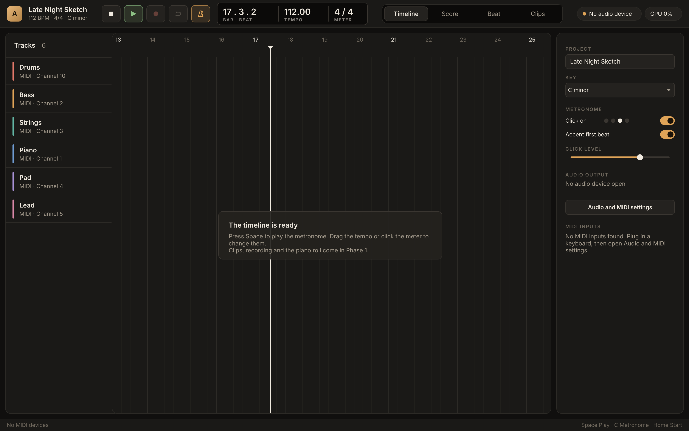
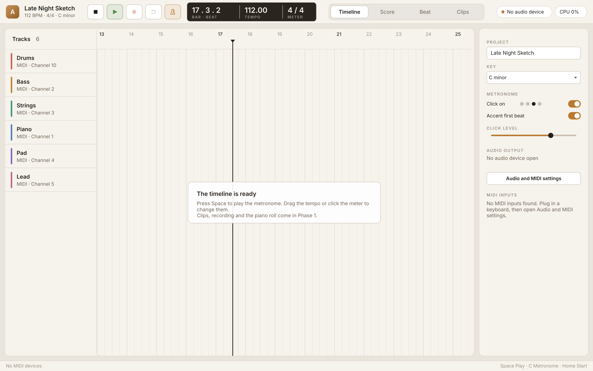

# Style guide

The look of Arranger MIDI DAW: a warm charcoal studio with a copper accent, modern but light. Taste references are LUNA (the app) and Sibelius (the score page), but the design is our own.

## Principles

- **Calm.** Dark warm greys, one accent colour, colour only where it means something (track colours, play, record, activity).
- **Fast to draw.** Everything is vector. No images, no shadows that need blurring, no animation that waits. Nothing repaints unless it changed, so an idle app uses close to 0% CPU.
- **One colour per track.** A track keeps its colour in every view: timeline, piano roll, score, beat grid and clip grid.
- **Keyboard first.** Every action has a command and a shortcut. A command palette comes later.
- **Themes are files.** Colours and sizes live in `resources/themes/*.json`. Change the file, not the code.

## Colours (dark theme)

| Token | Hex | Used for |
| --- | --- | --- |
| `background` | `#100f0e` | Window background, between cards |
| `panel` | `#1a1917` | Cards, header, status bar |
| `panelRaised` | `#24221f` | Buttons, fields, selected tab |
| `line` | `#2c2a26` | Dividers, grid lines |
| `lineStrong` | `#3a3631` | Borders of buttons and fields |
| `text` | `#efe9df` | Main text |
| `textMuted` | `#a39a8c` | Secondary text |
| `textDim` | `#6f685d` | Section labels, hints |
| `accent` | `#e0a458` | Copper accent: toggles, selection, the app badge |
| `playing` | `#8cc084` | Play button while playing |
| `recording` | `#e2786a` | Record button |
| `ok` / `warning` | `#8cc084` / `#e0a458` | Device status dots |
| `lcd` / `lcdText` | `#0b0a09` / `#efe9df` | Position, tempo and meter display |

Track colours: coral `#e2786a`, amber `#e0a458`, teal `#62b5a3`, blue `#6f9bd1`, violet `#a891d6`, green `#8cc084`, pink `#d987a8`. A project stores the colour **name**, so each theme can tune the shade.

The light theme (`light.json`) uses the same tokens on warm paper tones with a darker copper (`#b9792f`).

## Type

- **Inter** (SIL Open Font License, bundled in `resources/fonts`) for the whole UI. Regular for text, SemiBold for titles and values.
- Sizes: 16 for titles, 13 to 15 for body text, 11 for section labels (uppercase, letter-spaced), 20 for display values.
- The score page will use **Bravura** for notation and a serif for title and tempo text (Phase 4).

## Layout

- 4 px grid. Spacing is a multiple of 4; card gaps are 12.
- Corner radius 8 (6 for small fields, 12 for cards).
- Header 64 px: song, transport, display, view tabs, device status.
- Left: track list (248 px). Centre: timeline. Right: inspector (296 px). Bottom: status bar (28 px) with MIDI devices.
- Real-looking knobs only for synth parameters. Elsewhere: switches, sliders and numbers.

## Motion

Only what carries information: the playhead, the beat lights, MIDI activity dots, and later clip-launch countdowns and pad feedback. While playing, the UI refreshes at 60 Hz; when idle, 4 Hz.

## Mockups

The approved mockups (timeline, clips and beat, score, audio and slicer) are in the project files under `mockups/`. They are the target for Phases 1 to 6; the Phase 0 app shows only what works today.
