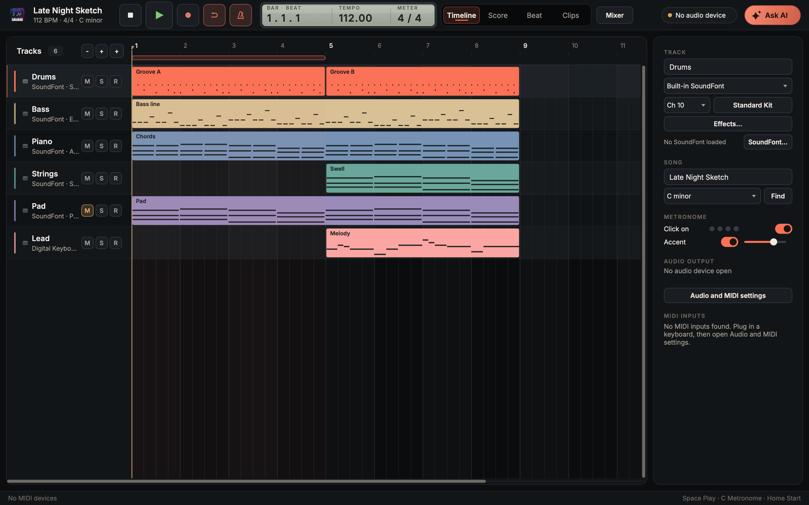
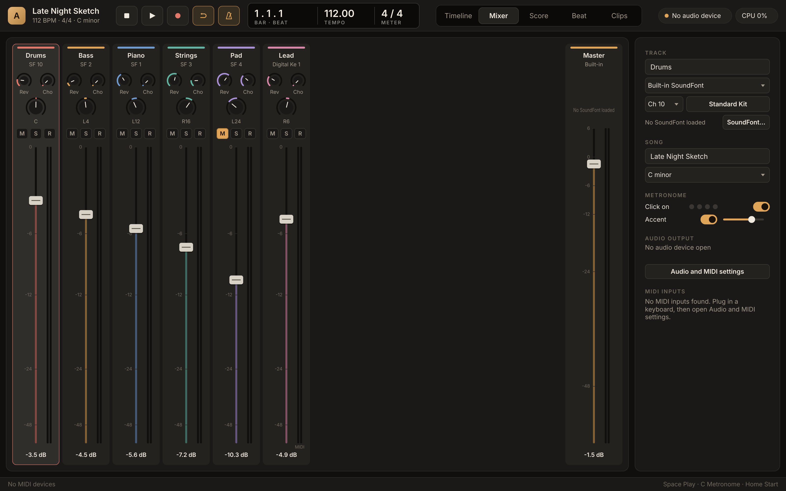

# User manual

This manual tells you how to use Arranger MIDI DAW. It includes only the
functions that the app has now. The manual gets a new section with each new
phase.

On Windows and Linux, use the `Ctrl` key where the manual says `Cmd`.

## Words in this manual

| Word | Meaning |
| --- | --- |
| Track | One instrument part. A track has an output, a sound and mixer controls. |
| Clip | A block of notes on a track. |
| Output | The place where a track plays: the built-in SoundFont player or a MIDI port. |
| MIDI port | A connection to a keyboard, synth or controller. |
| SoundFont | An SF2 file that contains instrument sounds. |
| Playhead | The vertical line that shows the song position. |
| Loop | The part of the song that plays again and again. |
| Device profile | A file that tells the app the sounds of one synth. |

## Quick start

1. Open the app.
2. Select `Options > Audio and MIDI Settings...`.
3. Select your audio output. Enable your MIDI keyboard as an input.
4. Select `File > Choose SoundFont...` and open an SF2 file.
5. Play your keyboard. You hear the sound of the selected track.
6. Push `R` to record. Play some notes.
7. Push `Space` to stop. The app makes a clip with your notes.
8. Push `Space` again to hear the clip.

## The main window

- **Top bar:** transport buttons, the position display, the tempo, the meter and the view tabs.
- **Left:** the track list.
- **Centre:** the timeline with the clips. The note editor opens below it.
- **Right:** the inspector. It shows the selected track, the song, the metronome and your devices.
- **Bottom bar:** the MIDI inputs. A dot comes on when a message arrives.

## Tracks

### Add a track

Click `+` above the track list, or push `Cmd+T`.

### Set the output and the sound

1. Click the track.
2. In the inspector, select the output: `Built-in SoundFont` or a MIDI port.
3. Select the MIDI channel. Use channel 10 for drums on most devices.
4. Click the sound button and select a sound.

The sound list comes from the SoundFont or from the device profile of the
MIDI port. If the app has no profile for the port, it shows the General MIDI
sounds.

### Change a track

- To rename a track, double-click its name.
- To move, duplicate, colour or delete a track, right-click the track.
- `M` mutes the track. `S` plays only this track. `R` arms the track for recording.

## Play and record

| Action | Key |
| --- | --- |
| Play or stop | `Space` |
| Go to the start | `Home` or `Enter` |
| Record | `R` |
| Loop on or off | `L` |
| Metronome on or off | `C` |

- To move the playhead, click the top half of the ruler.
- To set the loop, drag in the bottom half of the ruler.
- To change the tempo, drag the tempo value or double-click it.
- To change the meter, click the meter value.

### Record

1. Arm a track with `R` in the track list. If no track is armed, the app records on the selected track.
2. Push `R` on your computer keyboard. Playback and recording start.
3. Play your part.
4. Push `Space` to stop.

The app makes a new clip. The clip starts and ends on bar lines. To quantise
each recording automatically, select `Edit > Quantise While Recording`.

## Clips

| To do this | Do this |
| --- | --- |
| Add an empty clip | Double-click an empty area of a track |
| Select a clip | Click it. Drag on an empty area to select more than one. |
| Move a clip | Drag it. You can drag it to a different track. |
| Change the length | Drag the right edge |
| Duplicate | `Cmd+D` |
| Split at the playhead | `Cmd+E` |
| Join clips | Right-click and select `Join` |
| Delete | `Delete` |
| Open the note editor | Double-click the clip |

Clips snap to bars or beats. Hold `Alt` to move a clip freely.

To zoom, hold `Cmd` and turn the mouse wheel. On a trackpad, pinch.

## Note editor

Double-click a clip to open the note editor. Push `Esc` or click `Close` to
close it.

| To do this | Do this |
| --- | --- |
| Add a note | Click an empty area |
| Select notes | Click a note, or drag on an empty area |
| Move a note | Drag it left, right, up or down |
| Change the length | Drag the right edge of the note |
| Delete a note | Double-click it, or select it and push `Delete` |
| Move by a semitone | `Up` or `Down` arrow |
| Move by an octave | `Shift` + `Up` or `Down` arrow |
| Change the velocity | Drag in the velocity lane at the bottom |
| Select all notes | `Cmd+A` |
| Quantise | `Q`, or click `Quantise` |
| Hear a pitch | Click a key of the piano at the left |

The grid box sets the step for new notes, for movement and for quantise.
Hold `Alt` to ignore the grid.

`Quantise` moves the selected notes to the grid. If no notes are selected, it
moves all notes in the clip.

## Mixer

Click the `Mixer` tab, or push `Cmd+2`. Push `Cmd+1` to go back to the timeline.

Each track has a strip:

- **Rev** and **Cho** knobs: reverb and chorus level.
- **Pan** knob: left or right position.
- **M**, **S**, **R**: mute, solo, record arm.
- **Fader:** volume.
- **Meter:** the level of tracks that use the built-in SoundFont.

Drag a knob up or down to change it. Hold `Shift` for small steps.
Double-click a control to set it to its default value.

The `Master` strip sets the level of the built-in SoundFont player.

For MIDI ports, the strip sends MIDI controllers to your synth: volume (CC 7),
pan (CC 10), reverb (CC 91) and chorus (CC 93). A device profile can change
these numbers.

## Hardware controllers

The app has mixer pages for these controllers. Connect the controller and
enable its MIDI inputs. No other setup is necessary.

- Novation Launchkey Mini MK3
- Behringer X-Touch Mini
- Novation XioSynth 49 (you must make a template on the synth first)

[Controller mixer pages](controllers.md) shows the function of each knob and
button.

## Your synths

The app has device profiles for the Yamaha PSR-S970, the Roland D-05 and the
Novation XioSynth. It also has profiles for Roland GS and Yamaha XG devices.
The app selects the profile from the name of the MIDI port.

To add a synth, write a device profile. [Device profiles](device-profiles.md)
tells you how.

To set a synth to its default MIDI state, click the sound button and select
`Reset`. This item shows only if the profile has a reset message.

## Files

| Action | Menu | Key |
| --- | --- | --- |
| New project | `File > New` | `Cmd+N` |
| Open a project or a MIDI file | `File > Open...` | `Cmd+O` |
| Save | `File > Save` | `Cmd+S` |
| Save with a new name | `File > Save As...` | `Cmd+Shift+S` |
| Import a MIDI file | `File > Import MIDI File...` | `Cmd+Shift+I` |
| Export a MIDI file | `File > Export MIDI File...` | `Cmd+Shift+E` |

Project files have the extension `.arranger`.

When you import a MIDI file, each MIDI channel becomes one track. The app
keeps the tempo, the meter, the sounds and the mixer values from the file.

## Undo

Push `Cmd+Z` to undo the last change. Push `Cmd+Shift+Z` to redo it. The
`Edit` menu shows the name of the change.

## Look

Select `View > Dark Theme` or `View > Light Theme`.

## If something goes wrong

| Problem | What to do |
| --- | --- |
| No sound from a SoundFont track | Make sure that an audio device is open and a SoundFont is loaded. The inspector shows the two. |
| No sound from a synth | Make sure that the track output is the MIDI port of the synth and the channel is correct. |
| The keyboard does not record | Enable the keyboard as a MIDI input in `Audio and MIDI Settings...`. Look for the dot in the bottom bar. |
| A synth plays the wrong sound | Select the sound again. If the list is incorrect, check the device profile. |
| A controller does nothing | Enable all MIDI inputs of the controller. For the X-Touch Mini, make sure that the `MC MODE` light is off. |
